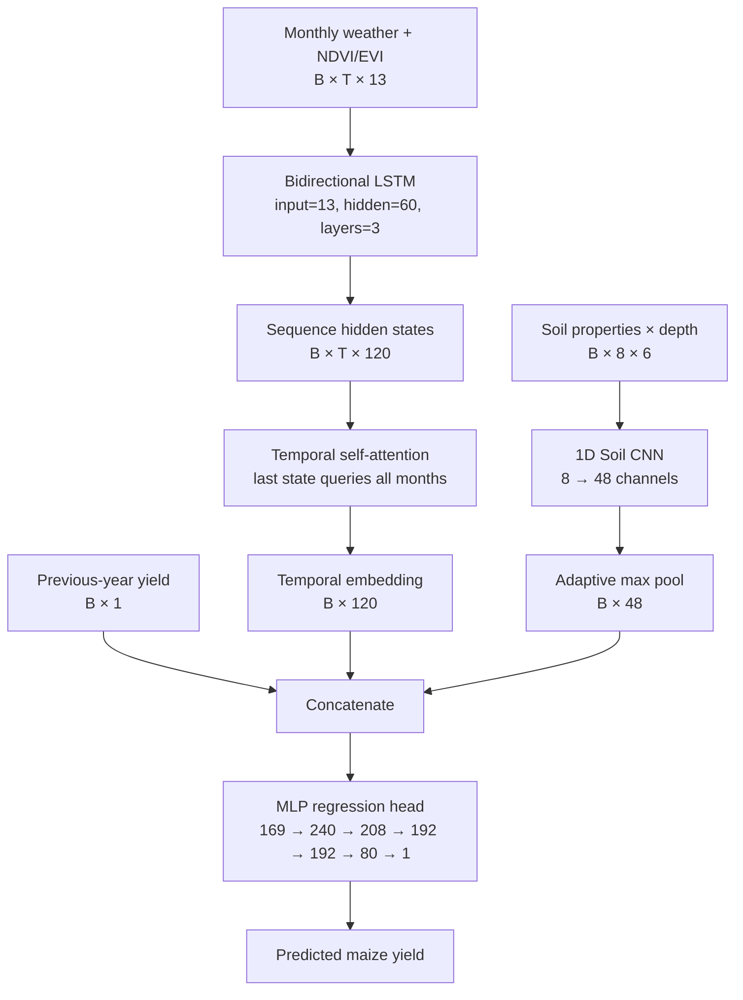

# DeepMaize architecture

This document describes the **existing inherited PyTorch implementation**, not a proposed redesign. The model class is `CNN_RNN` in `src/rnn/models.py`. The soil-enabled Kharif configuration is `src/rnn/config/maize_central_india.yaml`.

## Model at a glance

`B` is batch size and `T` is the configured number of months. With the provisional June-November calendar, `T=7`. The 13 temporal features are expected to be eleven weather variables (nine NASA POWER variables plus two derived VPD variables) and two satellite vegetation variables (NDVI, EVI). The builder does not hard-code 13; the network input dimension is inferred from the generated data.

## Temporal branch

**Input:** `(B, T, F)`, where `F` is the number of monthly weather/vegetation variables.

The configured recurrent layer is a three-layer bidirectional LSTM with hidden dimension 60 per direction. Its sequence output is therefore:

`(B, T, 2 × 60) = (B, T, 120)`.

Dropout between recurrent layers is controlled by `rnn_dropout_prob`. Layer normalisation is applied to the recurrent sequence when `use_layer_norm: true`.

### Self-attention

The implementation's `SelfAttention` is a single-query attention block over the LSTM sequence:

1. The final LSTM time-step vector is used to create the query.
2. Every time-step vector is projected into a key and value.
3. Scaled dot-product scores compare the final-state query with the keys for all months.
4. Softmax converts the scores to monthly attention weights.
5. The weighted sum of values is added residually to the final LSTM state.

The output has shape `(B, 120)`; the attention weights have shape `(B, T)`. This should not be confused with a multi-head Transformer block: it is the repository's last-state-query self-attention implementation.

## Soil branch

**Input:** `(B, 8, 6)` — eight soil-property channels and six ordered depth positions.

The property order is fixed in `data/soilgrids/wrangle.py`:

1. Soil organic carbon
2. Soil pH
3. Bulk density
4. Sand content
5. Silt content
6. Clay content
7. Cation-exchange capacity
8. Total nitrogen

Depth order is fixed from shallow to deep: 0–5, 5–15, 15–30, 30–60, 60–100 and 100–200 cm.

The configured SoilCNN contains one convolutional block with 48 output channels, kernel size 2, batch normalisation and ReLU, followed by adaptive max pooling over the depth axis. Its output is `(B, 48)`.

Soil is district-level/static in this adaptation. The dataset builder fits its soil standardiser on distinct districts appearing in the training split and applies that same scaler to all splits.

## Lagged yield and regression head

The immediately preceding sowing year's district yield is added as a direct scalar input. The builder only creates a lag if the exact previous year exists; it does not substitute an older non-consecutive year.

With soil enabled, the concatenated model representation is:

`120 temporal + 48 soil + 1 lagged yield = 169` values per district-season.

The configured fully connected head is:

`169 → 240 → 208 → 192 → 192 → 80 → 1`.

Each hidden layer uses ReLU and the configured fully connected dropout. The final scalar is the predicted yield. The no-soil experiment bypasses the SoilCNN and concatenates 120 temporal values with one lagged-yield value (121 values).

## Configuration provenance

The layer sizes, dropout, optimiser values and loss settings are initial values inherited from the wheat implementation's published proposed-model configuration. They are **not maize-optimised parameters**. The wheat paper's optimum is not evidence of a maize optimum. Any hyperparameter search must use the maize validation split only.

## Input/target shapes expected by the existing Dataset class

The generated split CSVs are read by `src/rnn/dataset.py`:

| Field | Meaning | Tensor shape per sample |
|---|---|---|
| `feature_sequence` | Monthly weather + vegetation features | `(T, F)` |
| `past_yield` | Scaled preceding-year yield | scalar |
| `soil_features` | Scaled soil property-depth matrix (optional) | `(8, 6)` |
| `Yield` | Target yield in the source unit | scalar |

The dataset class returns `(sequence, past_yield, soil_features, target)` when soil is enabled, and `(sequence, past_yield, target)` without soil.

## Leakage controls

- Split by sowing year before fitting feature scalers.
- Fit temporal and lagged-yield scalers on training records only.
- Fit static soil standardisation using training districts only.
- Use validation loss for early stopping and random-seed/checkpoint selection.
- Keep test metrics out of hyperparameter and model selection decisions.
- Compare against the persistence forecast `prediction = past_yield` in the original yield units.
